

  

<h1 align="center">Stem</h1>

  A desktop AI assistant that remembers you, reads your folders and runs jobs on a schedule. 
  It runs on the ChatGPT or Grok subscription you already pay for, any API key, or a local model.

  <a href="https://github.com/join3r/stem/releases/latest"><b>Download</b></a>
  · macOS (Apple Silicon) · Linux (AppImage, deb) ·
  <a href="docs/README.md">User guide</a>

<picture>
  <source media="(prefers-color-scheme: dark)" srcset="docs/screenshots/hero-dark.png">
  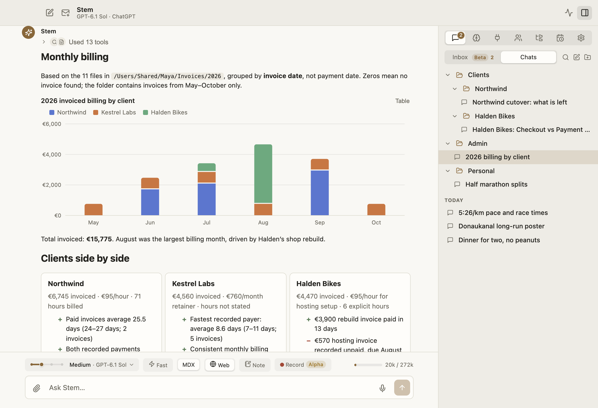
</picture>

## Answers you can scan

Replies render as MDX. You get charts, stat tiles, sortable tables, side-by-side comparisons, diagrams, step lists, quizzes and forms when the question calls for one, and a plain paragraph when it doesn't. Any chat can switch to Markdown.

<table>
  <tr>
    <td width="33%">
      <picture>
        <source media="(prefers-color-scheme: dark)" srcset="docs/screenshots/answer-diagram-dark.png">
        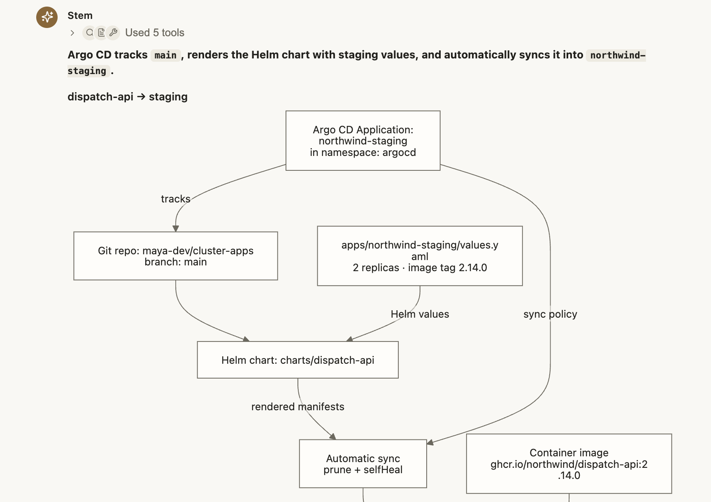
      </picture>
    </td>
    <td width="33%">
      <picture>
        <source media="(prefers-color-scheme: dark)" srcset="docs/screenshots/answer-compare-dark.png">
        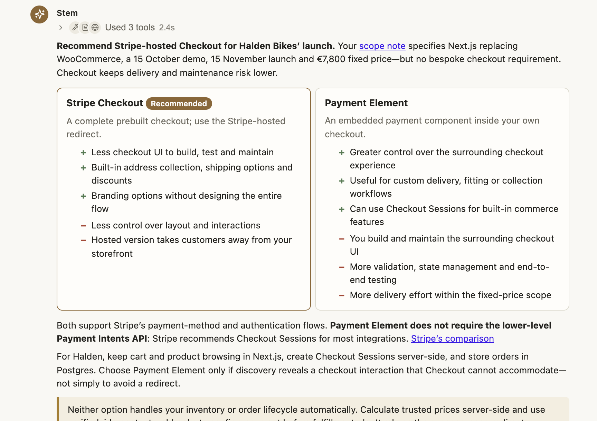
      </picture>
    </td>
    <td width="33%">
      <picture>
        <source media="(prefers-color-scheme: dark)" srcset="docs/screenshots/answer-picture-dark.png">
        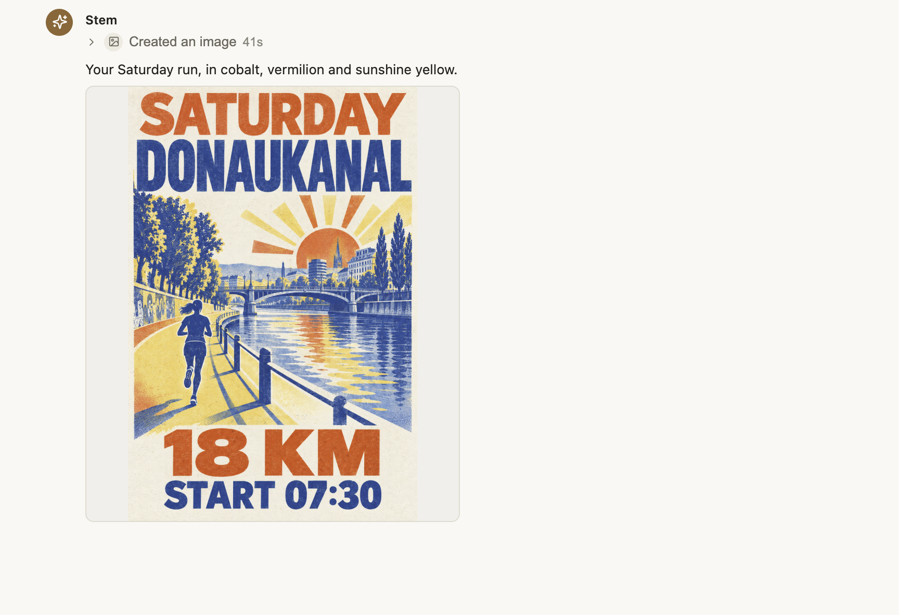
      </picture>
    </td>
  </tr>
  <tr>
    <td align="center">Diagrams</td>
    <td align="center">Comparisons</td>
    <td align="center">Pictures, on your ChatGPT plan</td>
  </tr>
</table>

## Memory you can audit

Stem pulls durable facts out of your chats and folders. Each message gets only the facts that matter for it, ranked on your machine by bundled models (the EmbeddingGemma 2 embedder, a Qwen3 reranker and Stem's own GTE Memory model). Every fact shows where it came from and whether the last answer used it. Pin, confirm or forget any of them, or switch memory off.

<picture>
  <source media="(prefers-color-scheme: dark)" srcset="docs/screenshots/memory-dark.png">
  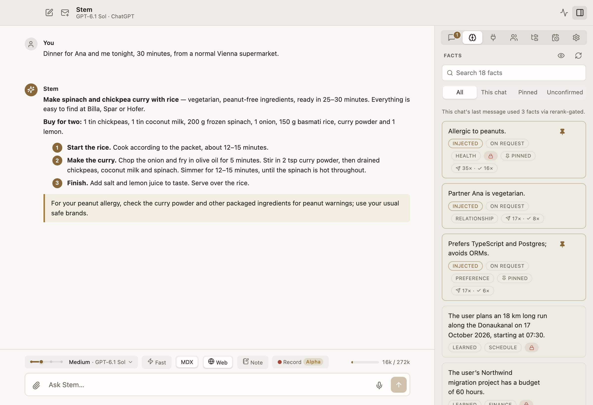
</picture>

Stem also keeps a short summary of you, written from your facts and from how you write, and sends it with every chat that can see your memory. You can edit it or switch it off. A deep check reads every fact against where it came from, fixes what it can prove, and mails you the rest: questions you answer with a click, and facts to keep or retire.

<picture>
  <source media="(prefers-color-scheme: dark)" srcset="docs/screenshots/memory-check-dark.png">
  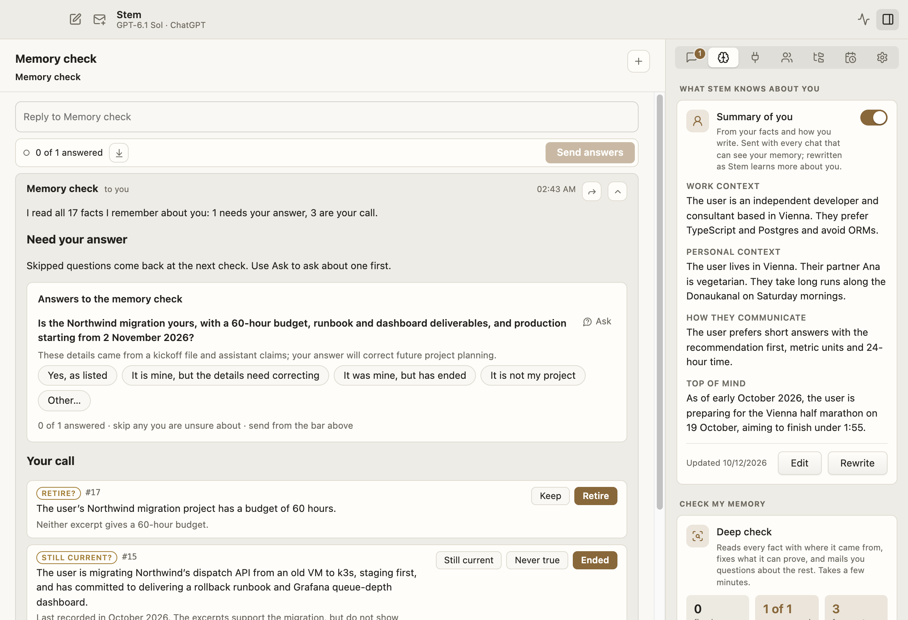
</picture>

## Your folders, read in place

Connect an Obsidian vault, a repo or a folder of invoices. Stem reads the files where they live and indexes them locally. Say what kind of folder it is (notes, code, documents, confidential) and Stem fills in the settings, or let it look inside and suggest them. Folders are read-only until you allow writes, and you decide per folder whether Stem may learn from it.

<picture>
  <source media="(prefers-color-scheme: dark)" srcset="docs/screenshots/folders-dark.png">
  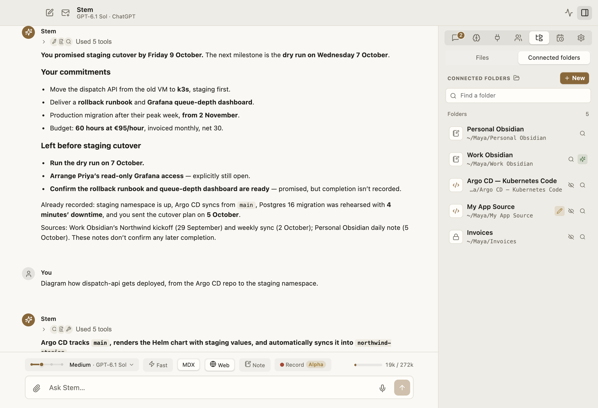
</picture>

## Personas and mail

A persona is a saved setup: instructions, model, tools, MCP servers, memory, a coding agent or a computer it may drive. You mail it like a colleague and the reply lands in the Inbox, newest on top. Scheduled tasks report here too, and only when they found something.

<picture>
  <source media="(prefers-color-scheme: dark)" srcset="docs/screenshots/mail-dark.png">
  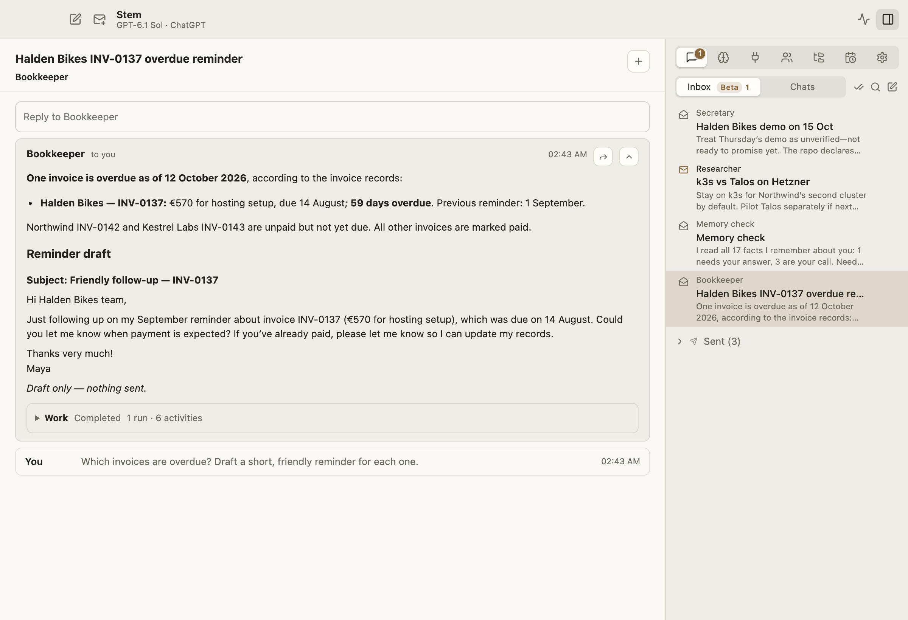
</picture>

A persona allowed to start helpers splits a big job. It starts named agents from your other personas, each works one piece, and you get one answer with their mails folded in under it.

<picture>
  <source media="(prefers-color-scheme: dark)" srcset="docs/screenshots/mail-agents-dark.png">
  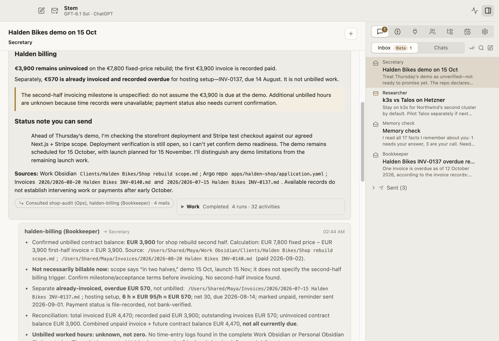
</picture>

## Quick Chat

A global shortcut opens Quick Chat over whatever app you're in. Ask, hit Enter, and it gets out of the way. A pill in the corner tells you when the answer is ready.

  <picture>
    <source media="(prefers-color-scheme: dark)" srcset="docs/screenshots/quick-chat-dark.png">
    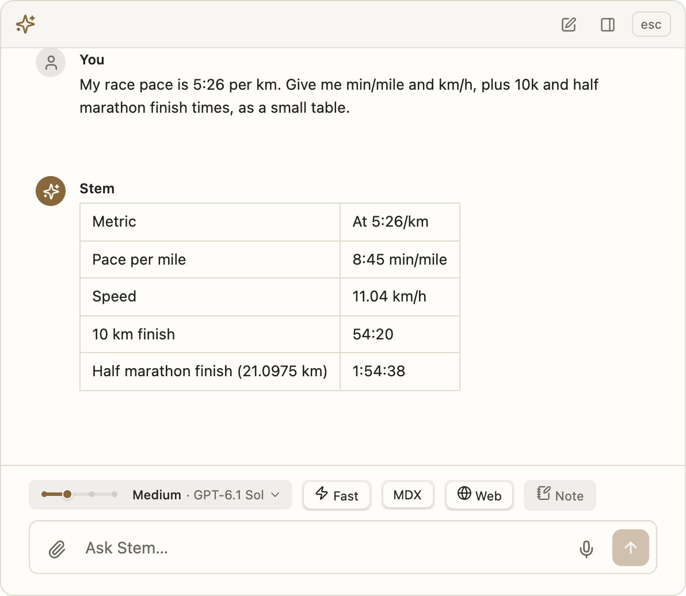
  </picture>
   
  <picture>
    <source media="(prefers-color-scheme: dark)" srcset="docs/screenshots/status-hud-dark.png">
    
  </picture>

## Also in the box

- **Coding agents.** A persona hands work to Claude Code or any other ACP agent, on the server or on one of your computers. The agent's permission requests arrive as cards in the chat.
- **Computer control (alpha).** A persona pinned to your Mac can work in its apps, including windows on another Space or behind other windows. macOS 14 or newer.
- **Skill recorder (alpha).** Record yourself doing a task on the Mac. Stem writes it up as a draft skill, and a practice run tries it before you save it.
- **Browser control.** The Stem extension for Chrome, Arc, Dia, Brave, Edge and Chromium lets Stem use your own signed-in browser in background tabs.
- **Scheduled tasks.** Ask for "every weekday at 8, check…" and you get a cron job. Each run starts in a fresh thread.
- **Shell commands.** A safety check runs what you asked for and turns the rest back. You decide only after repeated refusals, and you can always allow commands by name or pattern.
- **MCP servers and skills.** Add MCP servers by command or URL, OAuth included. Stem writes skills from work that went well and rewrites the ones that failed.
- **Pinboard.** Pin a message, a highlighted phrase or your own note to the top of a chat. Stem keeps the board in context for the rest of that chat.
- **Private chats.** A private chat doesn't read your memory and teaches it nothing.
- **Dictation.** The mic button transcribes with Apple's on-device speech models; the audio never leaves the Mac. macOS 26 or newer.
- **Long chats.** `/compact` condenses a chat's history when it gets long, with an optional focus for what to keep.
- **Themes.** Light, dark, bundled themes, or a JSON file of your own that can also set fonts and spacing.

<table>
  <tr>
    <td width="33%"><picture><source media="(prefers-color-scheme: dark)" srcset="docs/screenshots/panel-models-dark.png">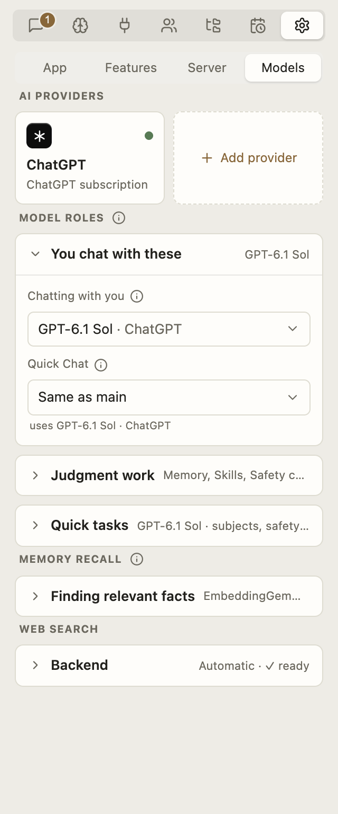</picture></td>
    <td width="33%"><picture><source media="(prefers-color-scheme: dark)" srcset="docs/screenshots/panel-features-dark.png">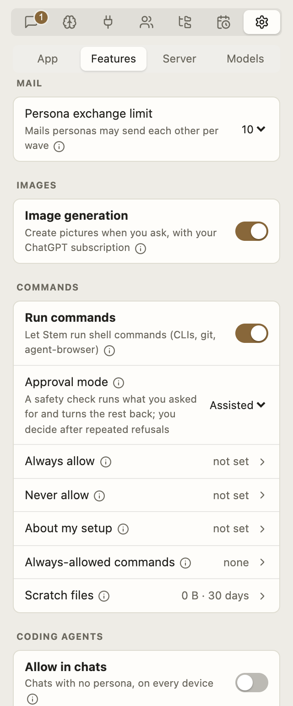</picture></td>
    <td width="33%"><picture><source media="(prefers-color-scheme: dark)" srcset="docs/screenshots/panel-personas-dark.png">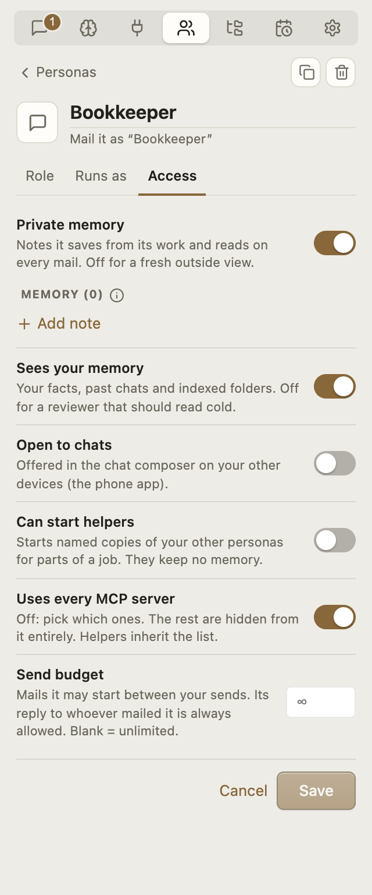</picture></td>
  </tr>
  <tr>
    <td align="center">Models</td>
    <td align="center">Features</td>
    <td align="center">A persona</td>
  </tr>
  <tr>
    <td width="33%"><picture><source media="(prefers-color-scheme: dark)" srcset="docs/screenshots/panel-tasks-dark.png">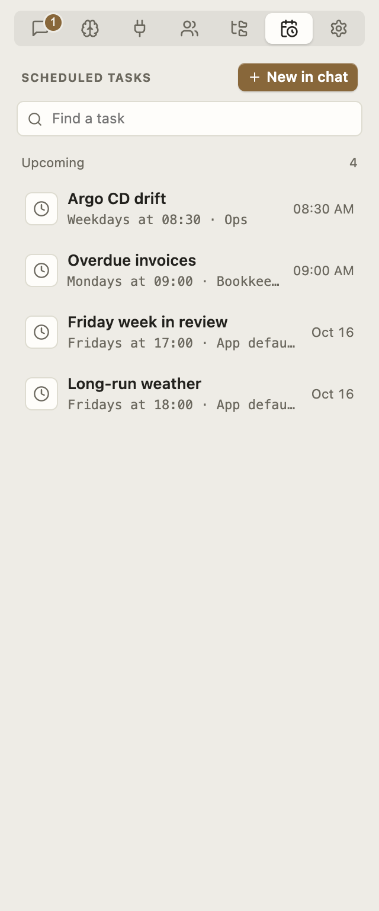</picture></td>
    <td width="33%"><picture><source media="(prefers-color-scheme: dark)" srcset="docs/screenshots/panel-task-runs-dark.png">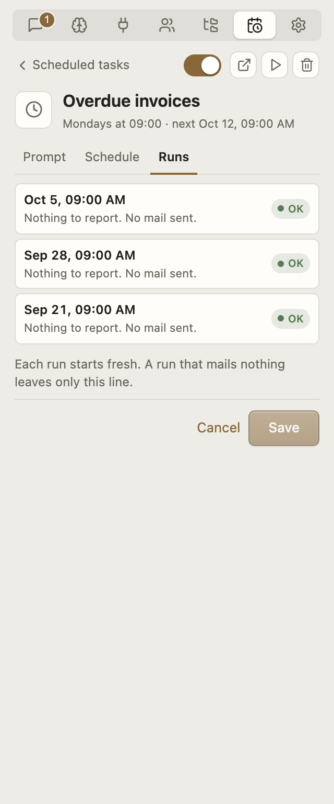</picture></td>
    <td width="33%"><picture><source media="(prefers-color-scheme: dark)" srcset="docs/screenshots/panel-folder-editor-dark.png">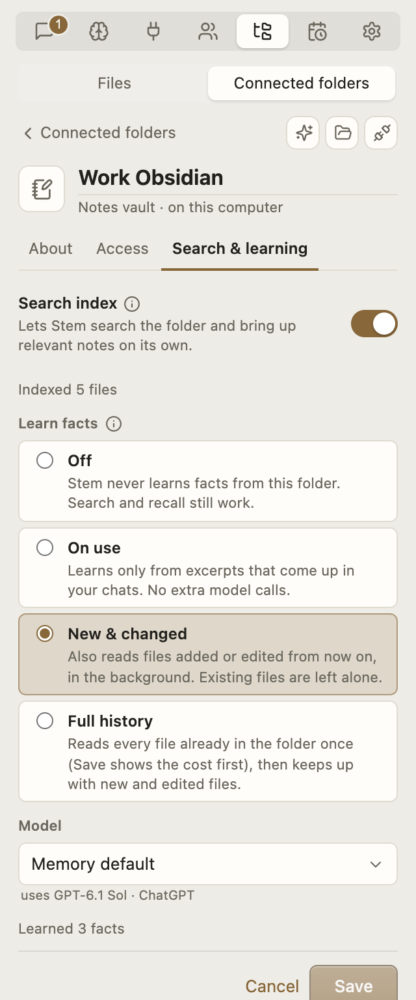</picture></td>
  </tr>
  <tr>
    <td align="center">Scheduled tasks</td>
    <td align="center">A task's runs</td>
    <td align="center">A connected folder</td>
  </tr>
  <tr>
    <td width="33%"><picture><source media="(prefers-color-scheme: dark)" srcset="docs/screenshots/panel-mcp-dark.png">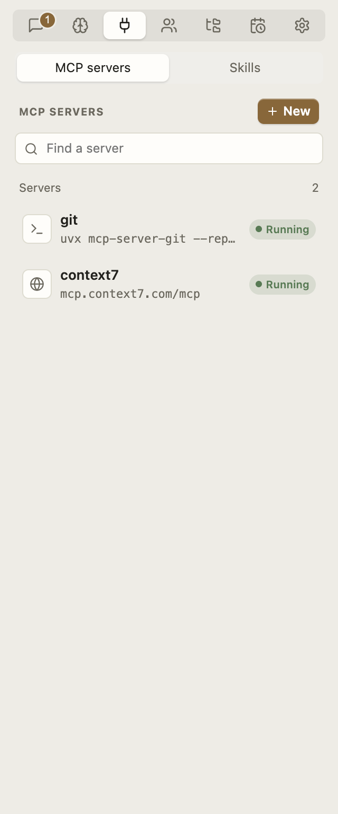</picture></td>
    <td width="33%"><picture><source media="(prefers-color-scheme: dark)" srcset="docs/screenshots/panel-skills-dark.png">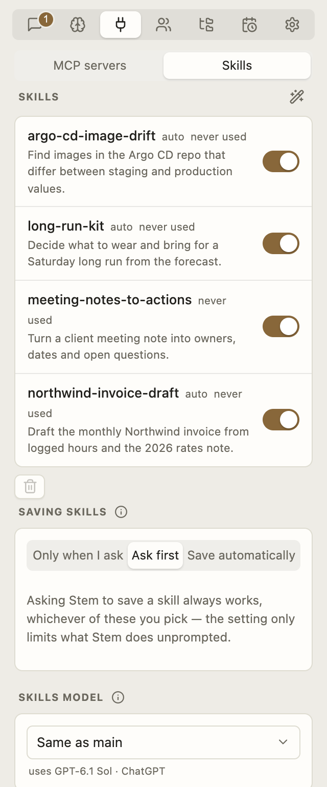</picture></td>
    <td width="33%"><picture><source media="(prefers-color-scheme: dark)" srcset="docs/screenshots/panel-folders-dark.png">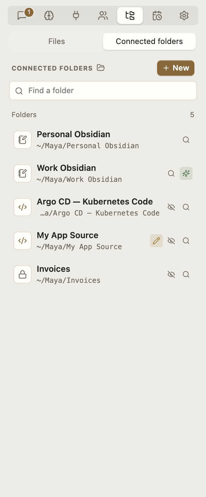</picture></td>
  </tr>
  <tr>
    <td align="center">MCP servers</td>
    <td align="center">Skills</td>
    <td align="center">Connected folders</td>
  </tr>
</table>

## Models

| Provider | How you connect |
| --- | --- |
| ChatGPT, Grok | Sign in with your subscription |
| Anthropic, OpenAI, OpenRouter, xAI | API key |
| Ollama, LM Studio | Local server, no key |
| Anything OpenAI- or Anthropic-compatible | Custom endpoint |

A Claude subscription doesn't cover Stem. Anthropic bills third-party apps from your extra usage, not your plan limits, so use an Anthropic API key for Claude models.

Switch models per chat, mid-conversation. Web search works with every model and cites its sources; a ChatGPT or Grok sign-in covers it without a separate search key.

## Run it on a server

By default Stem runs on your computer. Move it to a VPS with Docker and Caddy, or to a box on your Tailscale network, and every Mac, Linux machine and the iPhone app (beta) becomes a client of that one Stem. They share chats, memory and tasks, and scheduled runs fire while the laptop is closed. An MCP server or folder that only makes sense on your laptop stays pinned to it.

[Running on a server](docs/running-on-a-server.md) · [Running on a LAN or Tailscale](docs/running-on-tailscale.md)

## Install

Grab the latest build from [Releases](https://github.com/join3r/stem/releases/latest):

- **macOS.** `.dmg` for Apple Silicon, signed and notarized.
- **Linux.** `.AppImage` for any distro, or `.deb` for Debian and Ubuntu (also puts `stem` on your PATH). Both for x64 and arm64.

First launch walks you through signing in to a provider.

Linux notes

- **Quick Chat on Wayland.** Electron's global shortcuts don't fire in default GNOME and KDE sessions. Bind a system shortcut to `stem --quick-chat` (deb) or `/path/to/Stem.AppImage --quick-chat`; a second launch hands the toggle to the running app. On X11 the in-app shortcut works.
- **Tray.** The tray icon offers Summon Quick Chat, Open Stem and Quit. Stock GNOME hides tray icons without the [AppIndicator extension](https://extensions.gnome.org/extension/615/appindicator-support/); running `stem` again reopens the main window.
- **Closing the window** leaves Stem running in the background. Quit from the tray.
- **Secrets** are encrypted with the system keyring (`libsecret` or kwallet). Without one, Stem falls back to files readable only by your user (mode 0600).

## Build from source

Node.js 24 or newer, then `npm install && npm run dev`. Scripts, Windows and the rest are in [docs/development.md](docs/development.md).
